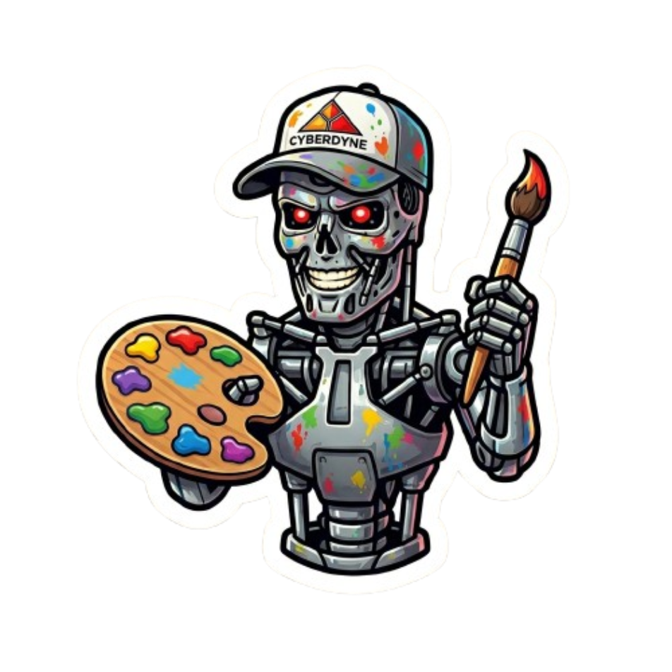

<table>
  <tr>
    <td>
      
    </td>
    <td>
      <h1>ImageTron</h1>
    </td>
  </tr>
</table>

Sube una imagen y conviértela automáticamente en un mundo 3D interactivo: un entorno navegable como Gaussian Splat (`.spz`) generado por World Labs, más un modelo 3D del objeto (`.glb`) generado por el proveedor que elijas.

---

## Cómo funciona

1. Subes una imagen desde el navegador y eliges el proveedor de modelo 3D
2. El backend lanza **dos jobs en paralelo**:
   - **World Labs** → genera el entorno 3D completo como Gaussian Splat (`.spz`)
   - **Proveedor de modelo** → genera el objeto 3D (`.glb`) con el proveedor elegido
3. El frontend muestra el progreso en tiempo real vía **Server-Sent Events**
4. En cuanto cada asset está listo, aparece en la escena 3D — sin esperar al otro
5. Cuando ambos terminan, la escena ocupa toda la pantalla con OrbitControls para rotar y explorar
6. **Si subes la misma imagen otra vez, los assets se sirven desde caché local** — sin rellamar a las APIs

---

## Caché por hash de imagen

Cada imagen genera un hash SHA-256 (16 chars) que se usa como ID del job y nombre de carpeta:

```
backend/outputs/
└── acf548744b89fc02/
    ├── source.jpg         ← imagen original
    ├── environment.spz    ← entorno World Labs (se reutiliza si ya existe)
    ├── model.glb          ← modelo 3D (se reutiliza si ya existe)
    └── metadata.json      ← fecha, provider, nombres de archivos
```

- **Misma imagen + mismo provider** → ambos assets desde caché, instantáneo
- **Misma imagen + distinto provider** → reutiliza el `.spz`, regenera solo el `.glb`
- **Imagen nueva** → genera todo y lo guarda

---

## Proveedores de modelo 3D

| Proveedor | Estado | Velocidad | Registro |
|---|---|---|---|
| **Local TRELLIS** | ✅ Gratis (self-hosted) | Depende del hardware | — |
| **Meshy** | ❌ API de pago | ~60 s | meshy.ai |
| **Replicate TRELLIS** | ⚠️ Requiere billing | ~25 s | replicate.com/account/api-tokens |
| **Tripo3D** | ❌ Free wallet no sirve para API | ~30 s | platform.tripo3d.ai |
| **Stable Fast 3D** | ❌ Créditos agotados rápido | < 1 s | platform.stability.ai |
| **FAL Hunyuan3D** | ❌ De pago | ~2 min | fal.ai |

> El entorno World Labs (`.spz`) siempre se genera independientemente del proveedor elegido y funciona correctamente.

**Nota sobre Replicate:** los tokens de sesión que genera el dashboard expiran en horas. Para uso en la app crea un token permanente en replicate.com/account/api-tokens.

---

## Local TRELLIS (servidor propio)

Puedes montar TRELLIS en una máquina con GPU y apuntar la app a ella — sin coste por llamada a API.

### Contrato REST esperado

El backend envía `POST /predictions` con la imagen en base64:

```json
{ "image": "data:image/jpeg;base64,..." }
```

El servidor puede responder de dos formas:

**Síncrona** (resultado inmediato):
```json
{ "output": "http://tu-servidor/model.glb" }
```
o
```json
{ "glb_url": "http://tu-servidor/model.glb" }
```

**Asíncrona** (procesamiento en background, polling cada 3 s):
```json
// POST /predictions → devuelve id
{ "id": "abc123", "status": "processing" }

// GET /predictions/abc123
{ "status": "succeeded", "output": "http://tu-servidor/model.glb" }
```

El campo `output` puede ser string o array de strings — se elige automáticamente el primer `.glb`.

### Configurar la URL en la UI

Selecciona **Local TRELLIS** en el selector de provider y aparece un campo de texto donde puedes cambiar la URL (por defecto `http://localhost:8000`). La URL se envía al backend en cada petición, no hace falta reiniciar nada.

---

## Requisitos

- Node.js 18+
- API keys en `backend/.env`

---

## Instalación y arranque

Un solo comando instala todo y levanta ambos servidores:

```bash
./start.sh
```

- Frontend: http://localhost:5173
- Backend: http://localhost:3001

> **Importante:** después de editar `.env` reinicia los servidores — `tsx watch` recarga el código pero no las variables de entorno.

---

## Configuración de API keys

Edita `backend/.env`:

```env
WORLD_LABS_API_KEY=      # worldlabs.ai → API settings
FAL_KEY=                 # fal.ai/dashboard → API keys
TRIPO_API_KEY=           # platform.tripo3d.ai → API keys
STABILITY_API_KEY=       # platform.stability.ai → API keys
REPLICATE_API_TOKEN=     # replicate.com/account/api-tokens (token permanente, no de sesión)
MESHY_API_KEY=           # meshy.ai → requiere plan de pago
PORT=3001
```

Solo necesitas las keys de los proveedores que vayas a usar. Si una key está vacía, ese proveedor falla con un error claro en la UI. **Local TRELLIS no necesita ninguna key.**

---

## Stack técnico

**Backend** — Express 5 + TypeScript
- `POST /api/generate` — recibe imagen, calcula hash, comprueba caché, lanza jobs en paralelo
- `GET /api/status/:jobId` — Server-Sent Events con progreso en tiempo real
- `GET /api/assets/:jobId/spz|glb` — sirve assets desde buffer en memoria (sin CORS)
- Las imágenes se redimensionan automáticamente a 1024×1024 antes de enviarlas a las APIs (usando `sharp`)

**Frontend** — Vite + React 19 + TypeScript + Tailwind CSS
- `useJobSSE` — hook que abre un `EventSource` y actualiza el estado reactivamente
- `SplatEnvironment` — renderiza el `.spz` con `@sparkjsdev/spark` (integración imperativa en R3F, rotación X corregida para World Labs)
- `GlbObject` — carga el `.glb` con `useGLTF` y lo auto-centra/escala en la escena
- `Viewer3D` — Canvas de React Three Fiber con OrbitControls

---

## Estructura del proyecto

```
imageTron/
├── start.sh                     ← instala todo y arranca ambos servidores
├── backend/
│   ├── .env                     ← tus API keys (no en git)
│   ├── .env.example             ← plantilla
│   ├── outputs/                 ← assets generados, organizados por hash de imagen (no en git)
│   └── src/
│       ├── index.ts
│       ├── types.ts
│       ├── routes/
│       │   ├── generate.ts      ← POST /api/generate (hash + caché + dispatch)
│       │   ├── status.ts        ← GET  /api/status/:jobId (SSE)
│       │   └── assets.ts        ← GET  /api/assets/:jobId/:type
│       └── services/
│           ├── jobStore.ts      ← estado en memoria + broadcast SSE
│           ├── outputStore.ts   ← caché en disco (hash → carpeta)
│           ├── imageResize.ts   ← redimensiona a 1024×1024 con sharp
│           ├── worldLabs.ts     ← World Labs API + polling 15s
│           ├── falApi.ts        ← FAL queue API + polling 10s
│           ├── tripoApi.ts      ← Tripo3D API + polling 10s
│           ├── stabilityApi.ts  ← Stability AI (respuesta directa)
│           ├── replicateApi.ts  ← Replicate TRELLIS + polling 5s
│           ├── meshyApi.ts      ← Meshy API + polling 8s
│           └── localTrellisApi.ts ← TRELLIS self-hosted + polling 3s
└── frontend/
    └── src/
        ├── App.tsx
        ├── types.ts
        ├── hooks/
        │   ├── useJobSSE.ts
        │   └── useImageUpload.ts
        ├── components/
        │   ├── UploadZone.tsx       ← drag-drop + selector de provider + URL campo local
        │   ├── ProgressPanel.tsx    ← barras de progreso en tiempo real
        │   └── Viewer3D.tsx         ← canvas 3D
        └── three/
            ├── SplatEnvironment.tsx ← Gaussian splat (Y-flip corregido)
            └── GlbObject.tsx        ← modelo GLB auto-centrado
```
